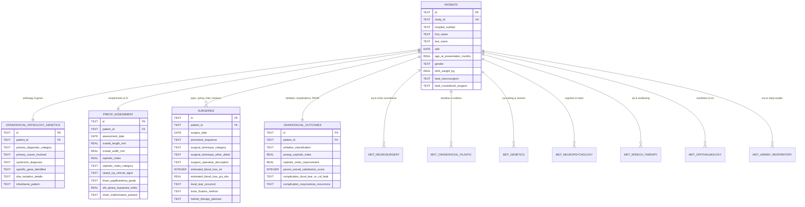

# Multidisciplinary Paediatric Craniofacial Database
## Complete Relational Schema Architecture & Clinical Specification

**Conceived, designed and tested: Dr G Narenthiran MB ChB BSc(MedSci)(Hons) MRCS(Ed.) FEBNS FRCS(SN). Copyright 2026, Dr G Narenthiran, g_narenthiran@hotmail.com, all rights reserved.**  
by **Dr G Narenthiran MB ChB BSc(MedSci)(Hons) MRCS(Ed.) FEBNS FRCS(SN)**  
*Dedicated with love and gratitude to Mrs Nirmaladevy Ganesalingam BSc.*

---

## 1. System Overview

The **Multidisciplinary Paediatric Craniofacial DB** is a dedicated clinical registry, biostatistical platform, and surgical audit database engineered specifically for paediatric craniofacial surgery:
- **Simple Craniosynostosis (Non-Syndromic Single-Suture)**: Sagittal (Scaphocephaly/dolichocephaly), Metopic (Trigonocephaly), Unilateral Coronal (Anterior Plagiocephaly), Bicoronal (Brachycephaly), Lambdoid (Posterior Plagiocephaly), Squamosal synostosis.
- **Complex & Syndromic Craniosynostosis**: Crouzon syndrome, Apert syndrome, Pfeiffer syndrome (Types 1–3), Saethre-Chotzen syndrome, Muenke syndrome, Craniofrontonasal Dysplasia (CFND), Carpenter syndrome, Jackson-Weiss, Antley-Bixler, Pan-synostosis / Cloverleaf skull (Kleeblattschädel).
- **Craniofacial Anomalies**: Tessier craniofacial clefts (0–14), frontoethmoidal and basal encephalocoeles, hypertelorism, orbital dystopia, and differential evaluation of deformational/positional plagiocephaly.

---

## 2. Relational Entity-Relationship Diagram

---

## 3. Data Tables Specification

### 3.1 `patients` Master Craniofacial Registry
| Field | Type | Description / Constraints |
| :--- | :--- | :--- |
| `id` | `TEXT PRIMARY KEY` | UUID unique patient record identifier |
| `study_id` | `TEXT UNIQUE NOT NULL` | Protocol study ID (e.g. `CF-001`) |
| `hospital_number` | `TEXT` | NHS / Hospital MRN |
| `first_name`, `last_name` | `TEXT` | Patient names |
| `dob` | `DATE` | Date of birth |
| `age_at_presentation_months` | `REAL` | Age at referral/presentation in months |
| `gender` | `TEXT` | Male, Female, Other, Unknown |
| `birth_weight_kg` | `REAL` | Birth weight in kg |
| `gestational_age_weeks` | `REAL` | Gestational age at delivery (weeks) |
| `head_circumference_at_birth_cm` | `REAL` | Birth occipitofrontal circumference (cm) |
| `lead_neurosurgeon` | `TEXT` | Lead Paediatric Neurosurgeon (e.g. Dr G Narenthiran) |
| `lead_craniofacial_surgeon` | `TEXT` | Lead Craniofacial Surgeon |
| `lead_plastic_surgeon` | `TEXT` | Lead Plastic Surgeon |

### 3.2 `craniofacial_pathology_genetics`
- **Primary Diagnostic Category**: Single-suture, multi-suture, syndromic, cleft, encephalocoele, hypertelorism, deformational plagiocephaly.
- **Suture(s) Involved**: Sagittal (scaphocephaly), metopic (trigonocephaly), unicoronal right/left (anterior plagiocephaly), bicoronal (brachycephaly), lambdoid right/left, pan-synostosis (cloverleaf skull).
- **Syndromic Classification**: Isolated/non-syndromic, Crouzon, Apert, Pfeiffer (1–3), Saethre-Chotzen, Muenke, CFND, Carpenter, Jackson-Weiss, Antley-Bixler, Opitz G/BBB, Cleidocranial dysplasia.
- **Molecular Genetic Findings**:
  - Gene identified: *FGFR2*, *FGFR3*, *FGFR1*, *TWIST1*, *EFNB1*, *TCF12*, *ERF*, *SMAD6*, *RAB23*, *ALX1-4*, *POR*, *RUNX2*, Negative, VUS.
  - DNA mutation details: cDNA change, amino acid substitution, exon number.
  - Mode of inheritance: De novo, Autosomal dominant (maternal vs paternal), Autosomal recessive, X-linked.

### 3.3 `preop_assessment` (Morphometry & Risk Profile)
- **Cranial Morphometrics**: Cranial length (A-P, mm), cranial width (biparietal, mm).
- **Cephalic Index (CI)**: Auto-calculated $(\text{Width}/\text{Length})\times 100$. Categorized as Scaphocephalic ($<75\%$), Mesocephalic ($75-80\%$), Brachycephalic ($80.1-85\%$), Hyperbrachycephalic ($>85\%$).
- **Craniofacial Symmetry**: Cranial Vault Asymmetry Index (CVAI %), intercanthal distance (mm), interpupillary distance (mm).
- **Intracranial Hypertension Assessment**: Suture ridging, fontanelle tension, beaten copper skull, papilloedema (Frisén Grade 0–5).
- **Airway & Respiratory**: Polysomnography Apnea-Hypopnea Index (AHI, events/hr), nocturnal $\text{SpO}_2$ nadir, CPAP/tracheostomy requirement.
- **Neuro-Anatomy**: Chiari I tonsillar herniation (mm descent), ventriculomegaly / Evans index.

### 3.4 `surgeries` (Operative Registry with Technique & Redo Options)
- **Procedure Sequence**:
  - `Primary Craniofacial Procedure`
  - `Redo Surgery / Secondary Vault Expansion`
  - `Staged Craniofacial Procedure (Stage 2 / 3)`
  - `Spring Insertion Procedure`
  - `Spring Removal Procedure`
  - `Distractor Insertion Procedure`
  - `Distractor Removal Procedure`
  - `Secondary Frontoorbital Advancement`
  - `Secondary Minor Contouring / Bone Grafting`
  - `Hardware Removal Alone`
  - `Wound Debridement / Re-exploration`
- **Surgical Technique Category**:
  - `Open Cranial Vault Remodeling` (FOAR, Total Vault, Pi, Bandeau advancement)
  - `Minimally Invasive / Minimal Access`
  - `Spring-Assisted Cranioplasty` (Spring details, force in N)
  - `Endoscopy-Assisted Strip Craniectomy`
  - `Helmet Therapy Alone (Orthotic Molding)`
  - `Distraction Osteogenesis (PVDO / FOAR Distraction)`
  - `Monobloc / Le Fort III Advancement`
  - `Other` (with mandatory free-text specification)
- **Surgeon's Narrative Description**: Full multi-line operative report.
- **Hemodynamics & Transfusion**: Duration (min), Estimated Blood Loss (EBL in mL and % of Estimated Blood Volume $\approx 80\,\text{mL/kg}$), PRBC, FFP, Cell saver autotransfusion, Tranexamic Acid (TXA) protocol.
- **Dural Integrity**: No tear, small primary suture repair, patch/graft repair, sagittal sinus tear.
- **Hardware & Post-Op Course**: Bone fixation method (resorbable plates/screws, titanium, wires, springs, distractors), custom orthotic helmet protocol duration (months), ICU stay, hospital stay.

### 3.5 `craniofacial_outcomes` (Whitaker & Parent Satisfaction)
- **Whitaker Classification**:
  - *Category I*: No further surgery considered advisable or desired (Optimal).
  - *Category II*: Minor surgical revisions of contour or soft tissue.
  - *Category III*: Major bone graft or repeat osteotomy (less than original).
  - *Category IV*: Major craniofacial reoperation duplicating initial extent (Redo Surgery).
- **Postoperative Morphometry**: Postop length, postop width, postop Cephalic Index, $\Delta\text{CI}$ normalization change.
- **Aesthetic Outcomes**: Forehead symmetry restored, supraorbital rim projection, resolution of orbital dystopia and exorbitism.
- **Parent Satisfaction (PROM)**: Overall score (1 to 5 Stars), head shape satisfaction, facial appearance satisfaction, recommendation to other families.
- **Complications**: Intraop/postop CSF leak, pseudomeningocele, surgical site infection (superficial vs deep bone flap osteomyelitis), bone flap resorption, hardware extrusion/infection, re-synostosis recurrence.

### 3.6 Multidisciplinary Team (MDT) Sub-Tables
- `mdt_neurosurgery`: ICP assessment, fundoscopy, Chiari position, ventricles, neurosurgical recommendations.
- `mdt_craniofacial_plastic`: Forehead/bandeau contour, midface projection, soft tissue/scarring, Whitaker stage estimate, surgical revisions.
- `mdt_genetics`: Clinical syndromic diagnosis, dysmorphology examination, inheritance pattern, recurrence risk counseling, prenatal advice.
- `mdt_neuropsychology`: Cognitive/developmental battery (Bayley-4, WPPSI, WISC), DQ/IQ score, gross and fine motor milestones, language, parental stress.
- `mdt_speech_therapy`: Feeding and swallowing, velopharyngeal competence (VPI status), hypernasality, speech articulation, therapy plan.
- `mdt_ophthalmology`: Visual acuity, cycloplegic refraction, strabismus (V-pattern), exorbitism (Hertel mm), corneal exposure, optic nerve OCT.
- `mdt_airway_respiratory`: Upper airway patency, choanal stenosis, adenotonsillar hypertrophy, polysomnography AHI, CPAP/tracheostomy.
